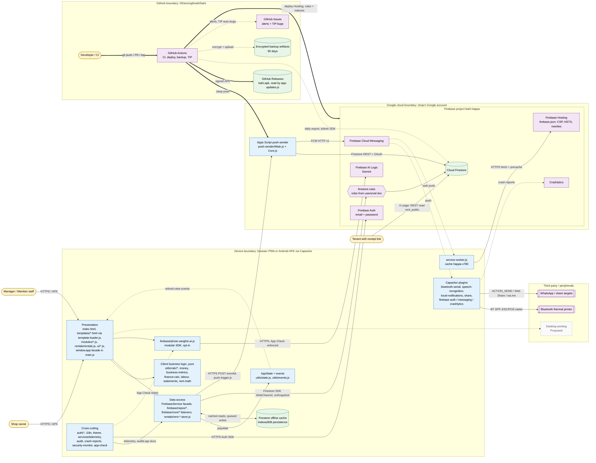
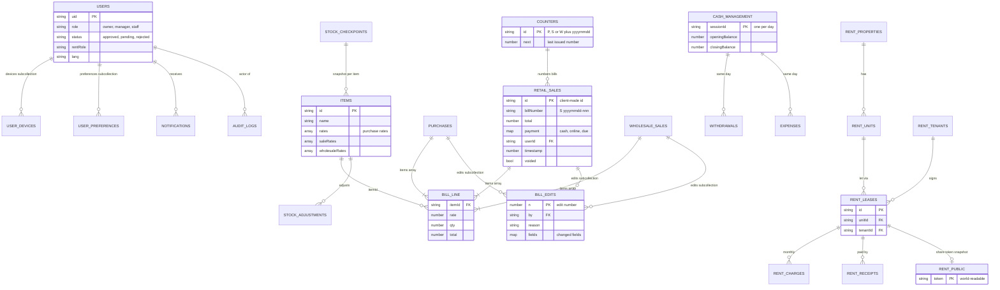
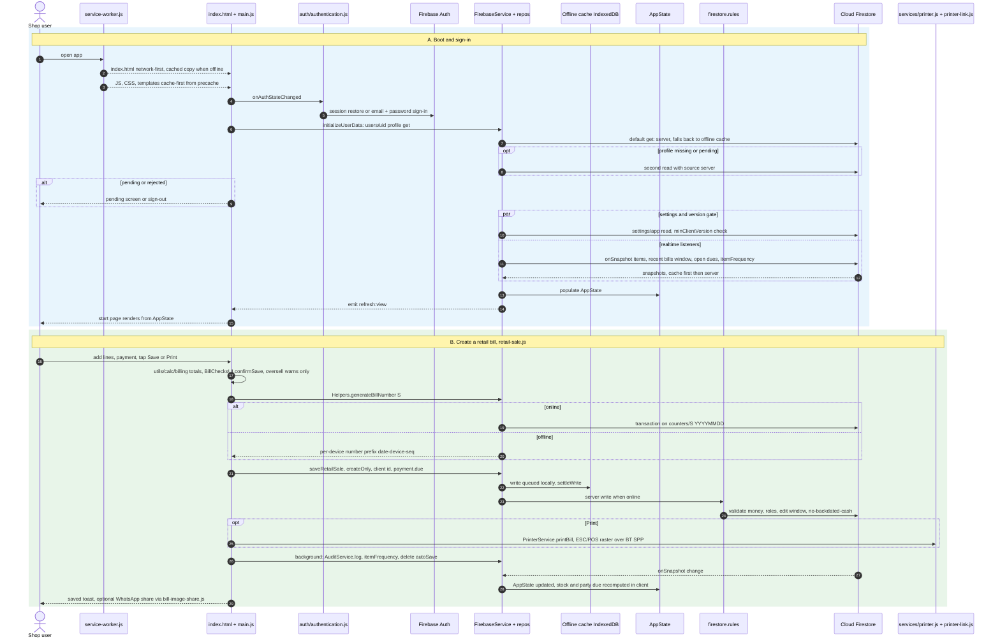
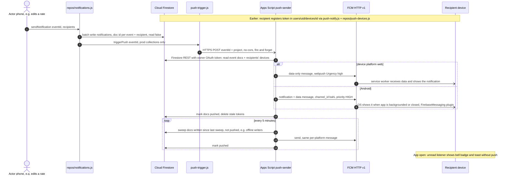
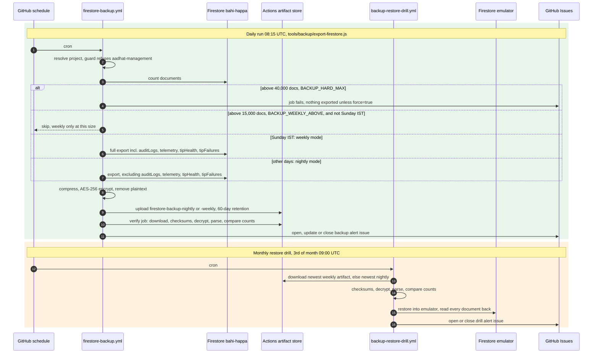
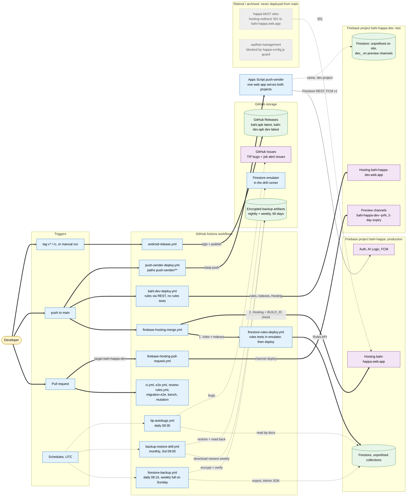

# Bahi by happa: High-Level Design

Hindi/English billing, stock, cash, money and rentals app for small traders (web + Android).

> **As of** `ce2207f8` (`main`), 2026-11-26.
> **The files in `diagrams/*.mmd` are canonical.** Keep the embedded copies below in sync with them.
> For layer rules, see [ARCHITECTURE.md](../project/ARCHITECTURE.md). For the decision log, see [DECISIONS.md](../project/DECISIONS.md).

**Legend:** blue = our code · purple = managed/external service or peripheral · green cylinder = data store · grey dashed = Proposed or retired · yellow = actor. Arrows: `-->` sync, `-.->` async/event, `==>` deploy/CI.

## 1. System architecture

Source: [`diagrams/system-architecture.mmd`](diagrams/system-architecture.mmd)

## 2. Overview

- **Serverless and single-tenant.** One Firebase project holds one shop. There are no Cloud Functions ([ADR-0002](decisions/ADR-0002-firebase-spark-no-backend.md)).
- **Thick vanilla-JS client.** The maths is pure client code, and pages are reached through `window.app` ([ADR-0001](decisions/ADR-0001-vanilla-spa-no-build.md)).
- **`firestore.rules` is the only server-side check** ([ADR-0003](decisions/ADR-0003-client-logic-rules-enforce.md)).
- **One data path.** Only `FirebaseService` and the repositories touch Firestore. `onSnapshot` fills `AppState`, and the data layer emits `refresh:<view>` events.
- **Offline-first** ([ADR-0004](decisions/ADR-0004-offline-first.md)).
- **Background work:**
  - Apps Script and FCM send push ([ADR-0005](decisions/ADR-0005-push-via-apps-script.md)).
  - GitHub Actions runs backup, TIP and deploys.
- **The same `www/` runs everywhere.** Hosting serves it, and the Capacitor APK ships it ([ADR-0007](decisions/ADR-0007-android-capacitor-github-releases.md)).

## 3. Data architecture

Source: [`diagrams/data-model.mmd`](diagrams/data-model.mmd)

There is **no per-shop hierarchy**: all collections sit at the root. `getCollection()` adds `dev_` on localhost and preview hosts. **Dues and stock are derived** from bills, and `payment.due` is the only stored due.

| Collections | Owner | Pattern |
|---|---|---|
| `purchases`, `retailSales`, `wholesaleSales` (+`edits`) | `repos/bill-*`, `core/listeners` | Realtime recent window plus open-due queries; create-only save; payments use transactions |
| `items`, `itemFrequency`, `stockAdjustments`, `stockCheckpoints`, `rate*`, `monthStats` | `repos/items`, `stock-records`, `bill-stats` | Items listener; stock = checkpoint + replay |
| `cashManagement`, `expenses`, `personalExpense*`, `withdrawals` | `repos/cash-*`, `expenses` | On demand; transactions or increments |
| `settings`, `counters` | `repos/settings`, `counters` | One read per app open; daily counter transaction |
| `users` (+`devices`, `preferences`), `workers`, `deviceLog` | `repos/users`, `user-profiles`, `push-devices` | Profile `get()`: server, cache when offline |
| `notifications`, `reminders`, `drafts`, `autoSaves`, `recurringBills` | matching `repos/*` | Batched writes; unread listener |
| `auditLogs`, `telemetry`, `anomalies`, `tip*` | matching `repos/*` | Append-only |
| `rent_*` | `rentals/rent-*-store.js` | Loaded with Rentals; `rent_public` is world-readable |

## 4. Component responsibilities

| Component | Responsibility | Depends on | Path |
|---|---|---|---|
| Shell and boot | Load order, theme, SW registration | Firebase compat 10.7.1 | `www/index.html`, `js/boot/` |
| Bootstrap | Auth state, user init, `window.app`, lazy pages | FirebaseService | `js/main.js`, `utils/template-loader.js` |
| Pages | Render calc results | AppState, events | `js/modules/`, `js/rentals/`, `js/ui/` |
| Business logic | Pure figures with spec IDs | none | `utils/calc/`, `business-metrics.js`, `finance-calc.js`, `labour.js`, `statements.js` |
| State | Store and event bus | none | `utils/state.js`, `events.js` |
| Data layer | Firestore, prefix, listeners, read meter | Firestore SDK | `js/firebase/` |
| Auth | Email sign-in, pending registration | Firebase Auth | `js/auth/` |
| Services | Print, share, audit, telemetry, App Check | Capacitor | `js/services/` |
| PWA | Precache, offline shell, web push | Hosting | `service-worker.js` |
| Config | Identity, targets, project guard | none | `happa.config.json`, `scripts/happa-config.js` |
| Rules | AuthZ and validation | Emulator tests | `firestore.rules`, `rules-tests/` |
| Push sender | FCM v1 and the sweep | Firestore REST | `push-sender/` |
| CI/CD | Gates, deploy, backup, TIP | Actions | `.github/workflows/`, `tools/` |

## 5. Critical workflows

### Boot and creating a bill

Source: [`diagrams/critical-workflows.mmd`](diagrams/critical-workflows.mmd)

**Boot:**
1. The SW serves `index.html` network-first, with a cached fallback; other assets come from the precache.
2. Auth restores the session.
3. Profile `get()` (cache only when offline); a missing or pending profile is re-read from the server, and a pending user is gated.
4. `settings/app` (`minClientVersion`) loads alongside the listeners, which fill `AppState`; the page renders.

**Creating a bill:**
1. Calc and `BillChecksUI` validate the bill. Overselling only warns.
2. The bill number comes from a counter transaction online, or a per-device sequence offline.
3. The create-only write is queued locally, then checked by the rules.
4. Printing starts once the write is issued.
5. Audit and `itemFrequency` update in the background.
6. The listener refreshes stock and dues.

### Push notification

Source: [`diagrams/workflow-push-notification.mmd`](diagrams/workflow-push-notification.mmd)

1. Docs are written in a batch, then `push-trigger.js` POSTs the event id (production only).
2. Apps Script reads the docs over REST and sends through FCM v1: data-only to the web (the SW shows it), notification+data to Android (the OS shows it when the app is closed).
3. It marks the docs `pushed` and prunes stale tokens.
4. A 5-minute sweep catches writers that were offline.

### Backup and restore drill

Source: [`diagrams/workflow-backup-restore.mmd`](diagrams/workflow-backup-restore.mmd)

1. Runs daily at 08:15 UTC:
   - Nightly runs skip `auditLogs`, `telemetry`, `tipHealth` and `tipFailures`.
   - The Sunday (IST) weekly run exports everything.
   - Above 15,000 docs, scheduled runs are weekly only; above 40,000 the job fails unless forced (`BACKUP_WEEKLY_ABOVE`, `BACKUP_HARD_MAX`).
   - Exports are encrypted with AES-256 and kept for 60 days.
2. A verify job checks the counts; alert issues open or close.
3. Monthly, the drill restores the newest **weekly** artifact (else the newest nightly) into the emulator and reads it back.

### Photo of weights (opt-in)

1. `photo-weights-ai.js` loads the modular SDK as a separate app, with an App Check token.
2. It calls Gemini through AI Logic.
3. The user confirms the lines. Nothing is stored.

## 6. Deployment architecture

Source: [`diagrams/deployment-architecture.mmd`](diagrams/deployment-architecture.mmd)

| Environment | Project | Entry | Collections | Deployed by |
|---|---|---|---|---|
| Production | `bahi-happa` | `bahi-happa.web.app`, `com.happa` | unprefixed | `firebase-hosting-merge.yml` (rules first); `android-release.yml` on `v*` |
| Test | `bahi-happa-dev` | `bahi-happa-dev.web.app`, `com.happa.dev` | unprefixed | `bahi-dev-deploy.yml`; manual `dev-latest` APK |
| PR preview | `bahi-happa-dev` | `…--pr<N>-…` channels | `dev_` | `firebase-hosting-pull-request.yml` |
| Local | checked-in config **`bahi-happa`**, or `?emulator=1` | `localhost` | `dev_` | developer |
| Retired / archived | `happa-bfc07` / `aadhat-management` | 301 / none | read-only / never | `hosting-redirect/` / blocked by guard |

**Rollback:** Hosting release history; rules by revert; Android fixes forward behind the `minClientVersion` gate.

## 7. Cross-cutting concerns

| Concern | Approach |
|---|---|
| AuthN | Firebase Auth email/password; new users start as `pending` staff. Google sign-in is built but off. |
| AuthZ | Rules read the role and status from `users/{uid}`; there are no custom claims. Some page permissions are UI-only ([role-permissions.md](../role-permissions.md)). |
| Boundaries | Enforced CSP, HSTS, `nosniff`, frame deny; SRI on vendored SDKs. App Check is enforced for AI Logic and monitors everything else. |
| Monitoring | `telemetry`, `auditLogs`, `security-monitor.js` feeding anomalies, Crashlytics, TIP issues, nightly prod smoke |
| Config and secrets | Public identity lives in `happa.config.json` and `config/targets/`. Service-account, signing and clasp secrets live only in GitHub secrets. |
| Errors | `write-settle.js` save states, `getWithRetry`, idempotent client ids, alert issues |

## 8. Key decisions

| ADR | Decision | Source |
|---|---|---|
| [0001](decisions/ADR-0001-vanilla-spa-no-build.md) | Vanilla SPA, no build step | D-001 |
| [0002](decisions/ADR-0002-firebase-spark-no-backend.md) | Spark plan, no backend | D-016, D-002 |
| [0003](decisions/ADR-0003-client-logic-rules-enforce.md) | Client logic, rules enforce | D-017, D-019 |
| [0004](decisions/ADR-0004-offline-first.md) | Offline-first | D-021, D-022 |
| [0005](decisions/ADR-0005-push-via-apps-script.md) | Push through Apps Script | D-024 |
| [0006](decisions/ADR-0006-prod-dev-projects.md) | Prod and test projects, `dev_` prefix | D-004 |
| [0007](decisions/ADR-0007-android-capacitor-github-releases.md) | APK through GitHub Releases | D-003 |
| [0008](decisions/ADR-0008-photo-weights-ai-logic.md) | AI Logic with App Check | D-015 |

## 9. Non-functional considerations

| Quality | Approach |
|---|---|
| Scalability | The limit is Spark quota (50k reads a day). Controls: history window, stock checkpoint, per-page read baselines (hard cap 300), session cap, `pauseBackgroundReads` kill switch. |
| Availability | Google-managed services; offline use from the SW precache and the IndexedDB cache. |
| Performance | [performance-budget.md](../performance-budget.md), checked nightly by `bench.yml`. Three pages load eagerly; the rest lazily. |
| Security | Rules tests run in the emulator on every PR and before the production deploy (the dev deploy skips them). No client secrets. Active bills are voided; only an owner may then delete a voided bill and its edits. |
| Reliability | Backup + drill (audit and logs only weekly); idempotent saves; rules before Hosting; `BUILD_ID` check. |

## 10. Assumptions, open questions and gaps

| Item | State |
|---|---|
| One shop per project | Assumption |
| Push while closed needs clasp secrets, a VAPID key and `GOOGLE_SERVICES_JSON` | Implemented, depends on configuration |
| Crashlytics and native Google sign-in need `GOOGLE_SERVICES_JSON` | Partial |
| App Check enforcement for Auth is a console setting | Open question |
| Localhost writes `dev_*` into the **production** project; the comment in `firebaseConfig.js` is stale (#35) | Open question |
| Role checks that are UI-only | Known gap |
| `services/` layer ([ARCHITECTURE.md §2](../project/ARCHITECTURE.md)) | Partial |
| Desktop printing ([desktop-printing.md](../desktop-printing.md)) | Planned |
| Browser reminders fire only while the app is open | Partial |
| Nightly backups omit logs; above 15,000 docs scheduled backups are weekly only | Known limit |
| AGENTS.md rule 7 mentions Functions; the DECISIONS.md index lacks D-024 | Doc gap |

## 11. Keeping this HLD current

Update the HLD in the **same PR** as any of these changes. Edit the `.mmd` file, then re-embed it here.

| Change | Update |
|---|---|
| A service, integration or external API | System diagram, §4, §7 |
| Collections, prefixing or derived data | Data model, §3 |
| Auth, roles or rules | §7, ADR-0003 |
| Communication patterns or background jobs | System and workflow diagrams |
| An environment, workflow or release channel | Deployment diagram, §6 |
| A major flow (boot, billing, sync) | `critical-workflows.mmd` |
| A hard-to-reverse choice | A new ADR plus a DECISIONS.md entry |

Draw anything not yet built with the dashed `planned` class, labelled **"Proposed"**. Bump the as-of line whenever you update this page.
