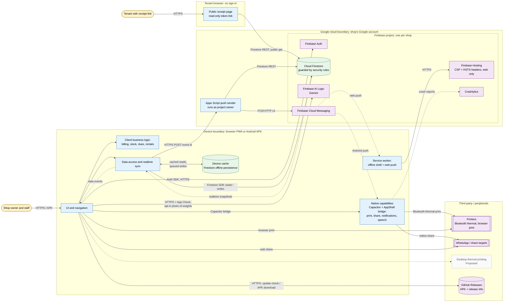
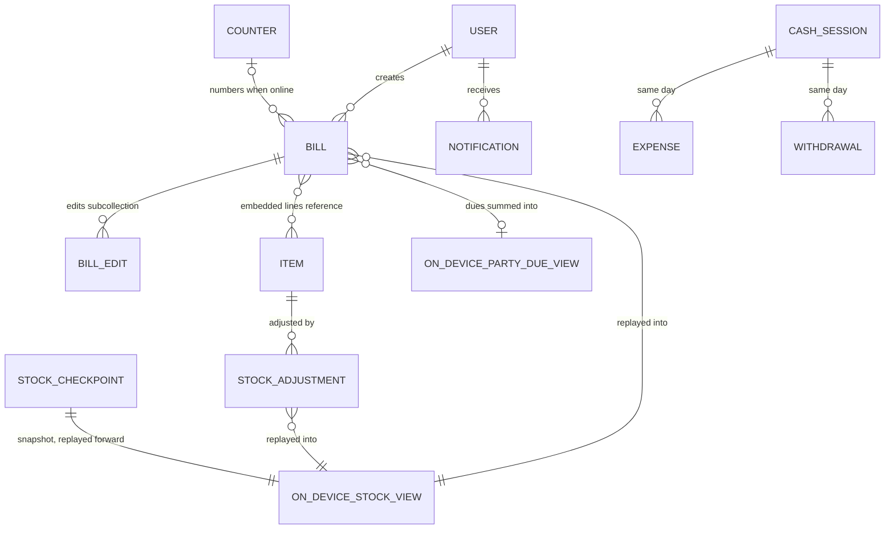
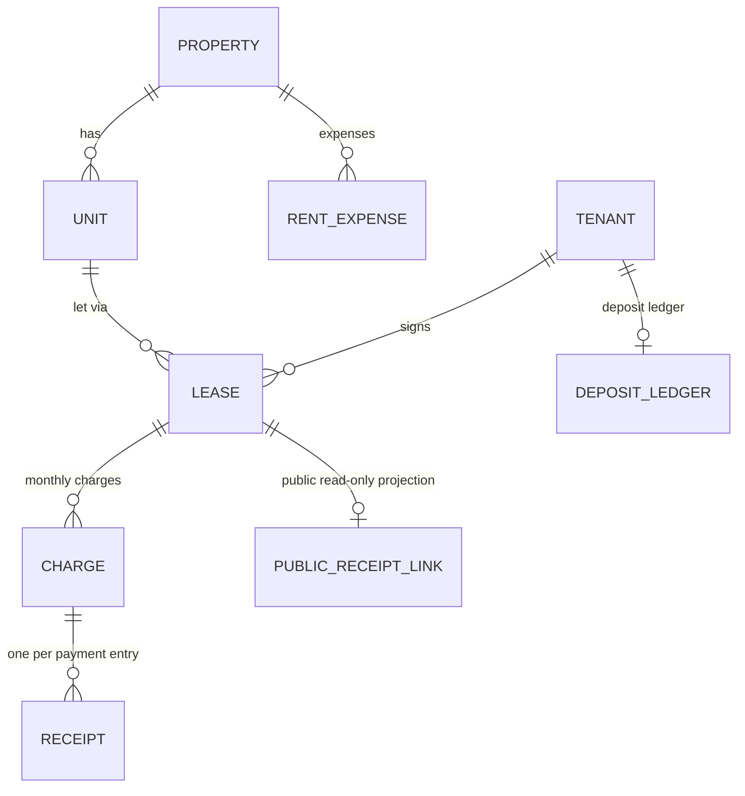
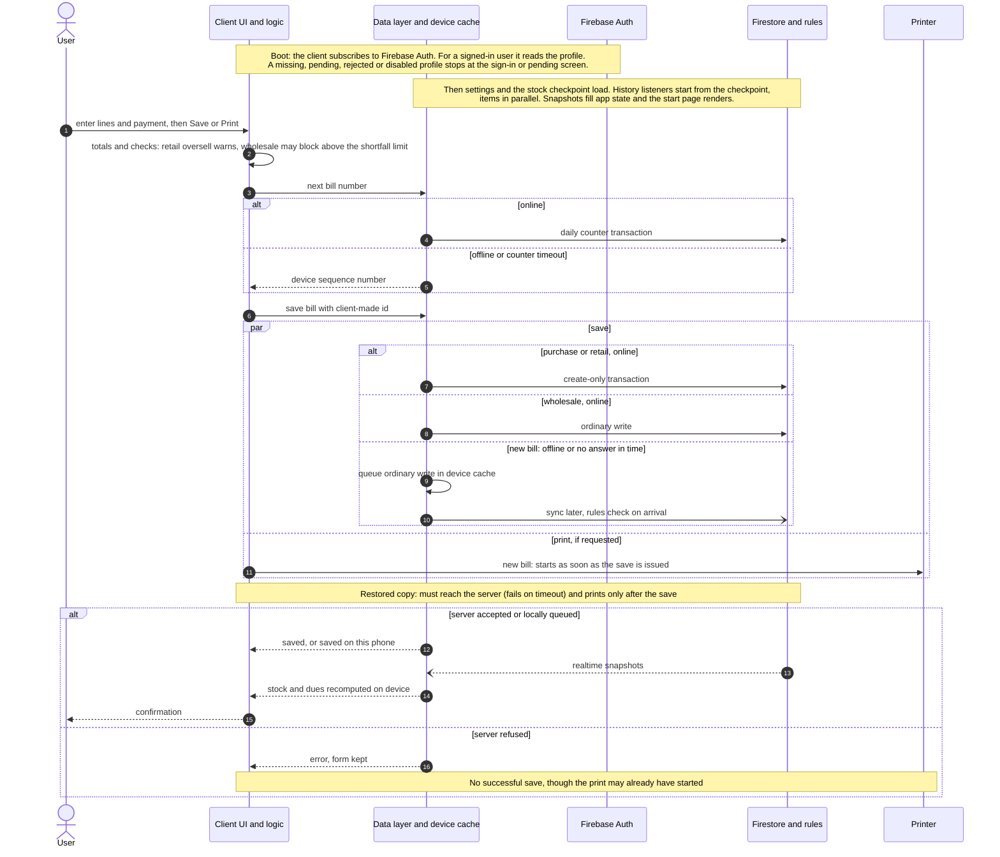
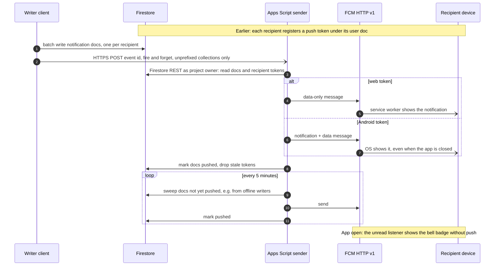
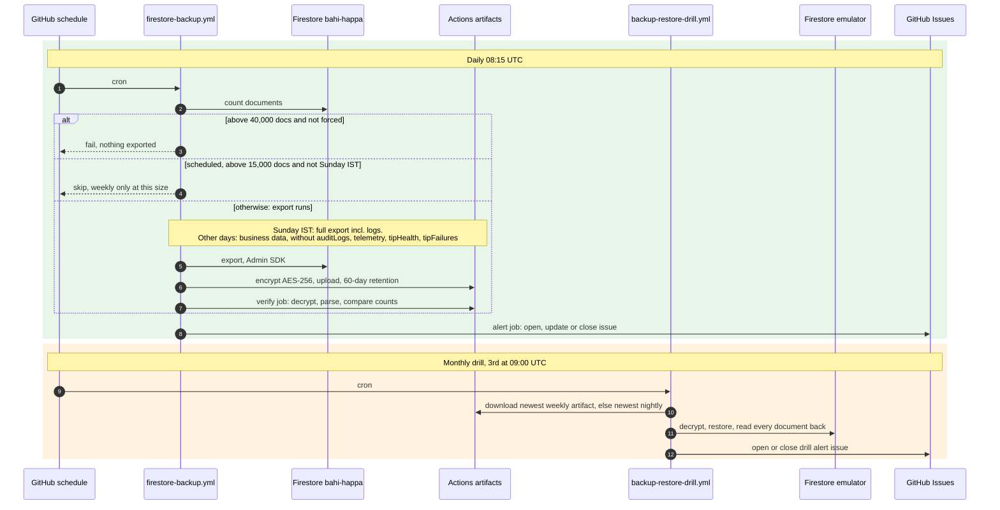
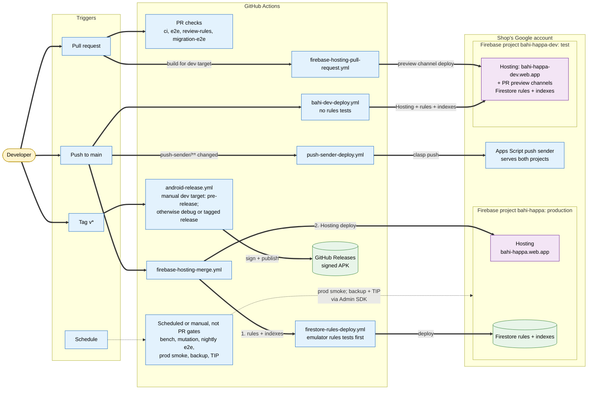

# Bahi by happa: High-Level Design

Hindi/English billing, stock, cash and rentals app for small traders, on web and Android.

> As of `ce2207f8`, 2026-11-26. `diagrams/*.mmd` are canonical; embedded copies must match.
> Legend (flowcharts): blue = ours · purple = external · green = store · dashed border = Proposed · solid arrow = call/request · dashed arrow = event/background · thick arrow = deploy. Sequence diagrams use standard call/return notation.

## 1. Architecture overview

- **One shop per Firebase project**; no app server or Cloud Functions ([ADR-0002](decisions/ADR-0002-firebase-spark-no-backend.md)).
- **Thick vanilla-JS client** holds UI and business logic ([ADR-0001](decisions/ADR-0001-vanilla-spa-no-build.md)); the same `www/` runs on Hosting and in the APK ([ADR-0007](decisions/ADR-0007-android-capacitor-github-releases.md)).
- **Trust model:** Firestore rules enforce client data access; privileged automation (Apps Script sender, backup and test-in-production (TIP) jobs) uses separately managed identities. Some page restrictions are UI-only ([ADR-0003](decisions/ADR-0003-client-logic-rules-enforce.md)).
- **One data path in the signed-in app:** only its data layer talks to Firestore. A separate public page reads token-linked rent receipts without sign-in.
- **Offline-first:** device cache, service-worker shell, device bill numbers ([ADR-0004](decisions/ADR-0004-offline-first.md)).
- **Push without a server** via Apps Script + FCM ([ADR-0005](decisions/ADR-0005-push-via-apps-script.md)).
- **Ops in GitHub Actions:** deploys, backup, TIP bug filing.

## 2. System architecture (runtime)

[source](diagrams/system-architecture.mmd)

## 3. Component responsibilities

| Component | Responsibility | Dependencies |
|---|---|---|
| UI and navigation (`index.html`, `js/main.js`, `modules/`, `rentals/`, `ui/`) | Boot, auth state, screens, `window.app` | Business logic, data layer |
| Business logic (`utils/calc/`, `business-metrics.js`, `rentals/rent-math*.js`) | Every displayed figure, as pure functions | None |
| Data layer (`js/firebase/`, `rentals/rent-*-store.js`) | Firestore access, listeners, collection prefix, read meter | Firestore SDK, device cache |
| Auth (`js/auth/`) | Email sign-in, pending registration | Firebase Auth |
| Services (`js/services/`) | Printing, sharing, audit, telemetry, App Check | Capacitor, AppShell bridge |
| Service worker (`service-worker.js`) | Offline shell, web push | Hosting, FCM |
| Rules (`firestore.rules`) | Data access and validation | Role and status in `users/{uid}` |
| Push sender (`push-sender/`) | FCM sends, 5-minute sweep | Firestore REST, FCM, owner account |
| Config (`happa.config.json`, `scripts/happa-config.js`) | App identity and build target | `config/targets/` |
| Public receipt page (`r.html`, `r/rent-history.js`) | Read-only rent history for a token link, no sign-in | Firestore REST, public `rent_public` get |

## 4. Data architecture

Each Firebase project holds one shop, with collections at the root. Bills are the source for **derived** stock and party dues. Each bill embeds its lines and keeps its edits in a subcollection, and stock checkpoints bound the replay. Firestore is the durable store; the device cache serves offline use. Rentals publish a read-only receipt projection for tenant links.

[source](diagrams/data-model.mmd)

[source](diagrams/data-model-rentals.mmd)

## 5. Critical workflows

### Boot and billing

[source](diagrams/critical-workflows.mmd)

1. Boot authenticates and loads the working state.
2. Billing calculates locally, then saves online or queues offline; new bills may print before server acceptance; restored copies after.
3. Realtime snapshots refresh stock and dues.

**Offline writes:** "saved on this phone" is not server acceptance. The sync pill counts pending writes; a later rules refusal is logged to TIP, not shown per bill (§9).

### Push notification

[source](diagrams/workflow-push-notification.mmd)

1. The writer stores notification docs and pings the sender.
2. The sender reads Firestore (REST) and sends via FCM: data-only to the web, notification to Android. A 5-minute sweep covers offline writers.

### Backup and restore drill

[source](diagrams/workflow-backup-restore.mmd)

1. Business data nightly; a full export including logs weekly. Encrypted, 60-day retention.
2. A verify job and an alert issue; a monthly restore drill into the emulator.
3. Volume limits can reduce or stop scheduled backups (`tools/backup/`).

**Photo of weights (opt-in):** AI Logic + App Check; the user confirms the lines; nothing is stored.

## 6. Deployment

[source](diagrams/deployment-architecture.mmd)

| Environment | Firebase project | Entry point |
|---|---|---|
| Production | `bahi-happa` | `bahi-happa.web.app`, APK `com.happa` |
| Test | `bahi-happa-dev` | `bahi-happa-dev.web.app`, PR previews, APK `com.happa.dev` |
| Local | checked-in config, i.e. `bahi-happa` | `localhost` |

The build target picks the **project**; the runtime picks the **collection prefix**. By default the prefix is `dev_` on browser localhost and preview channels, and none elsewhere. `?env=`, `?prod=1` (previews) or a saved `appEnv` override it. Rollback: Hosting release history, a reverted commit for rules, and fix-forward for Android behind `minClientVersion`.

## 7. Key decisions

[0001 No build step](decisions/ADR-0001-vanilla-spa-no-build.md) · [0002 Spark, no backend](decisions/ADR-0002-firebase-spark-no-backend.md) · [0003 Client logic, rules enforce](decisions/ADR-0003-client-logic-rules-enforce.md) · [0004 Offline-first](decisions/ADR-0004-offline-first.md) · [0005 Push via Apps Script](decisions/ADR-0005-push-via-apps-script.md) · [0006 Prod/test projects](decisions/ADR-0006-prod-dev-projects.md) · [0007 APK via GitHub Releases](decisions/ADR-0007-android-capacitor-github-releases.md) · [0008 AI Logic + App Check](decisions/ADR-0008-photo-weights-ai-logic.md). History is in [DECISIONS.md](../project/DECISIONS.md).

## 8. Non-functional considerations

| Quality | Approach |
|---|---|
| Scalability | Bounded by the Spark quota (50k reads a day). Controls: a history window, the stock checkpoint, per-page read baselines, a session cap and a kill switch for background reads. |
| Availability | Google-managed services. The app works offline from the service-worker shell and the device cache. |
| Performance | Budgets in [performance-budget.md](../performance-budget.md): selected metrics benchmarked nightly (`tools/bench/budgets.json`); others checked by release measurements and telemetry. |
| Security | Rules tests run on every PR and before the production rules deploy (the test deploy skips them). CSP and HSTS come from Hosting headers (web only; the APK WebView has no CSP); SRI on vendored SDKs. No secrets in the client. App Check is enforced for AI Logic. |
| Reliability | Client-made ids make saves idempotent. Rules deploy before Hosting, and a post-deploy build check follows. Backup plus restore drill. |
| Monitoring | Telemetry, the audit log, an anomaly scan, Crashlytics, TIP issues and a nightly production smoke test. |
| Config and secrets | Public identity lives in `happa.config.json`. Deploy keys live only in GitHub secrets. |

## 9. Assumptions and open questions

| Item | State |
|---|---|
| One shop per project; multi-shop would need a new project or a schema change | Assumption |
| Localhost uses the production project, with `dev_` collections | Open risk |
| Some page permissions are UI-only | Known gap |
| App Check on Auth and Firestore is monitor-only now; Auth enforcement is planned | Known state |
| A queued bill later refused by the rules has no per-bill alert | Open question |
| Production restore: [procedure exists](../../tools/backup/README.md#3-restore-into-bahi-happa-production); validated run and measured RTO | Open |
| Android WebView runs without CSP | Known risk |
| Desktop thermal printing | Planned |

## 10. Keeping this current

In any PR that changes the architecture, update the canonical `.mmd`, its embedded copy and the affected ADR. Architectural changes include services, schema, auth, integrations, background jobs, deployment and major flows. Draw anything not yet built dashed, labelled **Proposed**.
